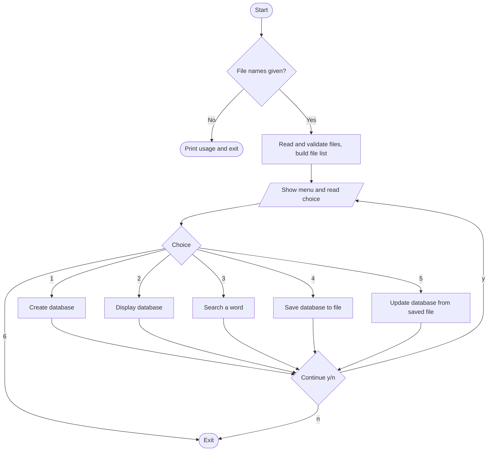
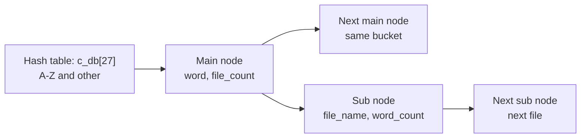

# Inverted Search in C

A command-line **inverted index** (word → files) built in **C** using a **hash table of linked lists**. Give it a set of `.txt` files and it records, for every word, **which files contain it and how many times**. You can then display, search, save and reload that database.

> Input files → hash table + linked lists → search any word → see its files and counts

---

## Table of Contents
- [Features](#features)
- [How It Works](#how-it-works)
- [Flowchart](#flowchart)
- [Data Structures](#data-structures)
- [Project Structure](#project-structure)
- [Build and Run](#build-and-run)
- [Input / Output](#input--output)
- [Module Details](#module-details)
- [Limitations](#limitations)
- [Future Improvements](#future-improvements)
- [Concepts Used](#concepts-used)
- [Author](#author)

---

## Features
- Reads multiple `.txt` files from the **command line**
- **Create** the inverted-index database from the files
- **Display** the full database as a table
- **Search** a word and see which files contain it and how many times
- **Save** the database to a backup file
- **Update** (reload) the database from a saved backup file
- Menu-driven interface with a continue (y/n) prompt

---

## How It Works

1. **Read and validate**: file names are taken from `argv` and stored in a linked list.
2. **Hashing**: every word goes into one of **27 buckets** based on its first letter (A-Z = buckets 0-25, anything else = bucket 26):
   ```c
   key = toupper(word[0]) % 65;
   if (key > 25 || key < 0) key = 26;
   ```
3. **Main nodes** hold a word and the number of files it appears in. Each main node has a list of **sub nodes**, one per file, holding the file name and the word count in that file.
4. **Save** writes each word as one line in a backup file; **Update** rebuilds the database from that file.

---

## Flowchart



---

## Data Structures



```c
typedef struct subnode  { int word_count; char file_name[30]; struct subnode *s_sub_link; } s_node;
typedef struct mainnode { int file_count; char word[30]; struct mainnode *m_main_link; struct subnode *m_sub_link; } m_node;
typedef struct filenode { char f_name[30]; struct filenode *link; } f_list;
typedef struct create_db { int key; m_node *m_link; } c_db;
```

---

## Project Structure

```
inverted-search/
├── main.c               # Menu and program flow
├── inverted.h           # Structures, macros, function prototypes
├── read_and_validate.c  # Argument checking and file list
├── create_database.c    # Builds the hash table
├── display_database.c   # Prints the database
├── search_database.c    # Word search
├── save_database.c      # Saves database to a backup file
├── update_database.c    # Loads database from a backup file
├── file1.txt            # Sample input
├── file3.txt            # Sample input
└── README.md
```

---

## Build and Run

**Requirements:** GCC

```bash
# Compile
gcc *.c -o inverted_search

# Run with one or more .txt files
./inverted_search file1.txt file3.txt
```

---

## Input / Output

**Input:** one or more `.txt` files, then a menu choice.

```
Select your choice among the following options:
1. Create DataBase
2. Display DataBase
3. Search DataBase
4. Save DataBase
5. Update DataBase
6. Exit
Enter your choice :
```

**Example: display (trimmed)**
```
Index    Word            Filecount       Files Name      Wordcount
[00]     are                1            file1.txt       1
[03]     doing              1            file1.txt       1
[05]     from               1            file3.txt       1
[07]     Harsh              1            file1.txt       1
```

**Example: search**
```
Enter the word you want to search : Harsh
-------------------------------------
The 'Harsh' is present in (1) files
file1.txt -> 1 times
-------------------------------------
```

**Backup file format (one word per line)**
```
#7;Harsh;1;file1.txt;1;#
```

---

## Module Details

- **`read_and_validate.c`**: stores file names in a linked list and checks for repeated names
- **`create_database.c`**: reads each word of each file, hashes it, and inserts or updates main and sub nodes
- **`display_database.c`**: walks all 27 buckets and prints every word with its files and counts
- **`search_database.c`**: hashes the search word, finds it in its bucket and prints the file list
- **`save_database.c`**: writes the database to a user-named backup file
- **`update_database.c`**: parses the backup file with `strtok` and rebuilds the nodes

> **Rule:** Create and Update are mutually exclusive. After one is used, the other is blocked, so the database is never loaded twice.

---

## Limitations
- Search is **case-sensitive** (the bucket is case-insensitive, but the word match is not)
- Words are split on whitespace only, so punctuation stays attached (for example `Hii..!`)
- Words are limited to 29 characters and file names to 29 characters
- Create and Update can each be used only once per run
- Saved words cannot contain spaces or `;`

---

## Future Improvements
- Strip punctuation and ignore case when indexing and searching
- Stronger file validation (empty, missing and non-`.txt` files)
- Dynamic buffers instead of fixed 30-character arrays
- Partial-word and multi-word search
- Free all allocated memory on exit

---

## Concepts Used
- Hash tables and hashing on the first character
- Singly linked lists, nested (list of lists)
- Dynamic memory allocation (`malloc`)
- Command-line arguments
- File handling and string parsing (`fscanf`, `fprintf`, `strtok`, `atoi`)
- Multi-file C programs with header files and include guards

---

## Author
**Harsh Kadam**: Mechatronics Engineering student (MMIT, SPPU), interested in embedded systems, robotics, and semiconductors.

⭐ If you found this project useful, consider giving it a star!
